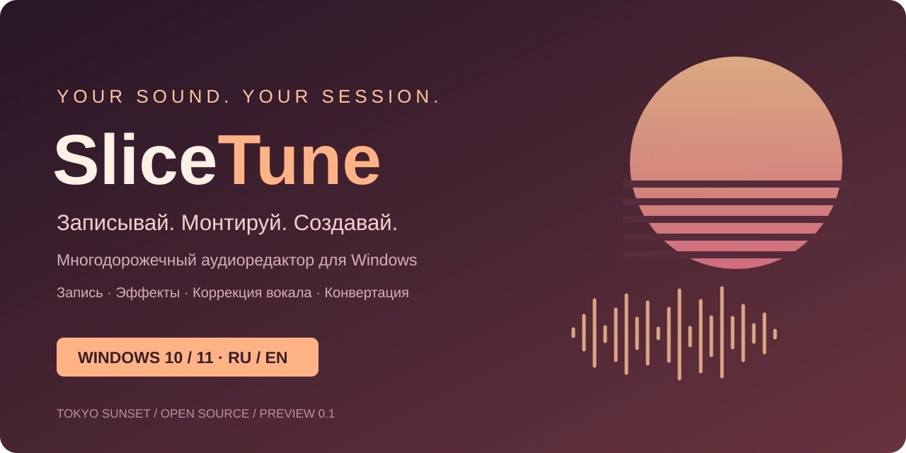
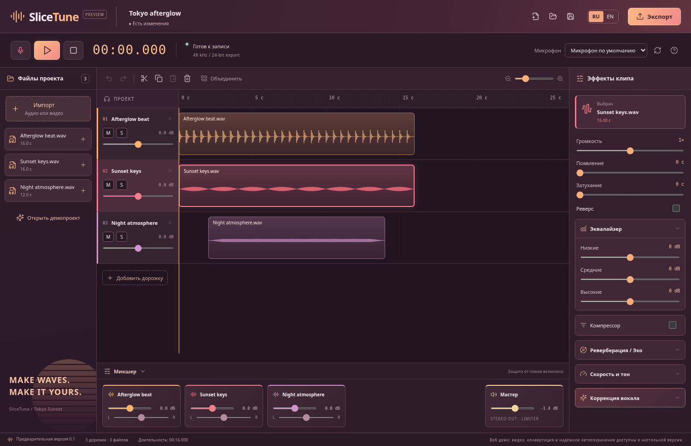

<p align="center"></p>

<p align="center"><strong>Твой звук. Твоя сессия.</strong><br>Многодорожечный аудиоредактор для Windows 10/11 x64.<br>Русский и английский интерфейсы · Tokyo Sunset · Локальная обработка</p>

<p align="center"><a href="https://github.com/plogiat/SliceTune/releases">Скачать для Windows</a> · <a href="#начало-работы">Начало работы</a> · <a href="#english">English</a></p>

## Для чего нужен SliceTune

Записать голос поверх музыки, смонтировать подкаст, подготовить озвучку, соединить аудиофайлы, достать звук из видео или конвертировать запись. Все клипы находятся на общей шкале времени: их можно переносить, обрезать и обрабатывать, сохраняя исходные файлы внутри проекта.

Интерфейс в стиле **Tokyo Sunset** сочетает сливовые панели, тёплые коралловые и оранжевые акценты. Кнопки и карточки слегка увеличиваются при наведении; при настройке «уменьшить движение» анимация отключается. Клип при наведении подсвечивается, сохраняя точные границы монтажа.

## Возможности версии 0.1



| Работа | Что доступно |
| --- | --- |
| Запись | Выбор микрофона, новая дорожка с позиции курсора, запись под существующую музыку |
| Монтаж | Перемещение между дорожками, обрезка краёв, разделение, копирование и вставка, удаление, склейка дорожки |
| Звук | Громкость, панорама, mute / solo, реверс, плавное появление и затухание |
| Эффекты | Трёхполосный EQ, компрессор, реверберация, эхо, защита выхода от пиков |
| Скорость и тон | Скорость 0,25–4× с сохранением высоты тона; отдельный сдвиг тона ±12 полутонов |
| Коррекция вокала | Экспериментальная обработка готового сольного голоса: тоника, лад, сила коррекции |
| Файлы | Аудиоимпорт, извлечение первого аудиопотока из видео, экспорт WAV / MP3 / FLAC / OGG |
| Проекты | Переносимый `.slicetune` с исходниками и обработанными файлами, отмена / повтор, автосохранение и восстановление |
| Языки | Переключение RU / EN без перезапуска |

Скорость, высота тона и коррекция вокала создают новый файл; оригинал остаётся в библиотеке. Изменения монтажа и эффектов можно отменить. Для конвертации импортируйте файл и экспортируйте его в нужный формат. Для последовательной склейки разместите клипы на одной дорожке, затем нажмите «Объединить»; наложенные клипы будут сведены вместе.

## Установка Windows

Откройте раздел [Releases](https://github.com/plogiat/SliceTune/releases). После успешной сборки тега там появляются:

- `SliceTune-0.1.0-Setup-x64.exe` — установщик с выбором папки.
- `SliceTune-0.1.0-Windows-x64.zip` — распакуйте **весь архив** и запустите `SliceTune.exe`.

FFmpeg входит в настольную сборку; отдельно устанавливать его не нужно. Предварительные сборки не имеют подписи издателя. Наличие исходников в репозитории само по себе не означает, что сборка релиза уже завершена: её статус виден во вкладке Actions.

## Начало работы

1. Нажмите **«Импорт»**, выберите аудио или видео. Каждый файл создаст новую дорожку. Для знакомства можно открыть встроенный демопроект.
2. Перемещайте клипы мышью. Тяните края, чтобы обрезать. Нажмите на линейку для установки курсора, выберите клип и нажмите **S** для разделения.
3. Для записи нажмите кнопку микрофона. Запись появится отдельной дорожкой с позиции курсора. Повторное нажатие или «Стоп» завершит запись. Используйте наушники, чтобы музыка не попала в микрофон.
4. Выберите клип и настройте эффекты справа; громкость и панораму дорожек — в микшере снизу.
5. Сохраните `.slicetune` для продолжения монтажа или выберите **«Экспорт»** для готового аудиофайла. Можно экспортировать весь проект, выбранную дорожку или клип.

В настольной версии резервная копия записывается в каталог данных приложения через 1,8 с после изменений. При следующем запуске доступно восстановление последней копии. Это одна резервная сессия; она не заменяет явное сохранение нужных проектов.

### Горячие клавиши

| Клавиши | Действие |
| --- | --- |
| Пробел | Воспроизведение / пауза |
| R | Начать / завершить запись |
| S | Разделить выбранный клип по курсору |
| Delete | Удалить клип |
| Ctrl+C / Ctrl+V | Копировать / вставить клип |
| Ctrl+Z / Ctrl+Shift+Z | Отменить / повторить |
| Ctrl+S / Ctrl+O | Сохранить / открыть проект |
| Alt при перемещении | Отключить привязку к 0,1 с |

## Границы предварительной версии

- Запись дорожек по очереди с одного выбранного входа. ASIO, несколько одновременных входов и мониторинг с низкой задержкой пока не реализованы.
- Коррекция вокала работает **после записи**, рассчитана на монофонический голос и может создавать артефакты. Это базовый алгоритм определения высоты и изменения тона, а не лицензированный плагин Antares Auto-Tune. Для сложных партий используйте короткие фрагменты; лимит обработки — 5 минут.
- Экспорт: до 30 минут с хвостом эффектов, стерео 48 кГц. WAV — 24-битный контейнер; проект и промежуточные аудиофайлы кодируются в 16-битный PCM. MP3 — 320 кбит/с. Исходные файлы выше 16 бит при импорте квантуются.
- До 128 дорожек, исходный файл до 500 МБ, проект до 512 МБ. Обработка происходит в памяти: большие проекты требуют существенно больше оперативной памяти, чем размер файла.
- Веб-режим служит демонстрацией редактора. FFmpeg-конвертация, импорт видео и надёжное восстановление доступны в настольном приложении. Веб-экспорт WAV — 16 бит.
- Сохранение проекта открывает диалог выбора файла. Импорт видео извлекает звук; видеомонтажа нет.
- Удаления «эффектов ИИ», разделения песни на инструменты, VST-плагинов и автотюна во время записи в этой версии нет.

## Разработка

Требуется Node.js **24 LTS** и npm. Используйте существующий checkout; отдельное рабочее дерево для обычного запуска не нужно.

```sh
npm ci
node node_modules/electron/install.js
npm run build
npm run desktop
```

`npm run dev` запускает веб-демо Vite. После изменения интерфейса для настольной проверки повторите `npm run build` и перезапустите Electron. Node 24 при работе через HTTPS-прокси поддерживает `NODE_USE_ENV_PROXY=1`; не отключайте TLS-проверку.

```sh
npm test                         # модель проекта, монтаж, WAV, высота тона, RU/EN
npx playwright install chromium # браузер для тестов, если не установлен системный Chromium
npm run test:e2e                  # браузер: монтаж, запись, проекты, экспорт, коррекция
node scripts/desktop-smoke.mjs    # после build: реальный Electron + FFmpeg
npm run dist:win                  # на Windows: установщик и ZIP
```

На Linux desktop smoke использует headless-режим Electron. Для системного Chromium можно указать `CHROMIUM_PATH`. В обычной Windows-сборке скачивание Electron и FFmpeg требует доступа к GitHub и npm. Переменная `SLICETUNE_FFMPEG` позволяет разработчику указать совместимый FFmpeg вместо встроенного.

**Автоматизация:** Checks проверяет модель, сборку и браузерные сценарии. Windows release на теге `v*` запускает настольную проверку на Windows, собирает NSIS и ZIP и публикует предварительный GitHub Release. Его можно запустить вручную для получения артефактов без релиза.

## English

**SliceTune** is an open-source multitrack audio editor for Windows 10/11 x64: record voice over music, edit clips, mix tracks, extract audio from video and convert between WAV, MP3, FLAC and OGG. It includes a Tokyo Sunset interface, Russian / English localization, offline effects and experimental monophonic vocal pitch correction. Portable project files contain all source audio; desktop autosave provides recovery after restart.

Get the installer or complete ZIP from [Releases](https://github.com/plogiat/SliceTune/releases) after the Windows release workflow succeeds. Preview builds are unsigned. Recording uses one selected microphone at a time; real-time autotune, ASIO, VST and stem separation are outside this version. Export is limited to 30 minutes, project size to 512 MB. Internal project audio is 16-bit PCM; desktop WAV export uses a 24-bit container. All audio processing runs locally.

Development: Node 24, `npm ci`, `node node_modules/electron/install.js`, `npm run build`, `npm run desktop`. Run `npm test`, `npm run test:e2e` and `node scripts/desktop-smoke.mjs` for validation. On Windows, `npm run dist:win` creates installer and ZIP.

## Лицензия / License

GPL-3.0-only. Зависимости и источники сторонних компонентов перечислены в [THIRD_PARTY_NOTICES.md](THIRD_PARTY_NOTICES.md). Лицензии Electron / Chromium также поставляются в собранном приложении.
